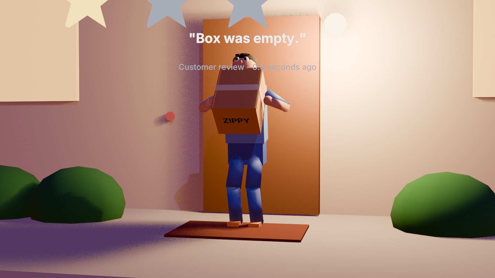

# Delivery in 0.8 Seconds

A 15-second, 100% procedural Blender Python film for the RenderJuice "Speed" contest.

- Video: https://youtu.be/EgwntXBSEVE
- Devpost: https://devpost.com/software/delivery-in-0-8-seconds



A delivery drone races through a dusk city and drops its box in 0.8 s. The box is empty.

- `delivery.py` – builds and animates the whole scene headless (bpy 5.2, EEVEE)
- `evolution_of_speed.py` – shared helper library (materials, primitives, IK, text, render setup)
- `delivery_audio.py` – synthesizes the soundtrack with numpy/scipy (no samples)
- `make_delivery_video.sh` – ffmpeg glow/grade/encode
- `delivery_submission_text.md` – contest write-up and AI/third-party disclosure

## Run
```
blender -b -P delivery.py -- --frames 1 360 --out delivery_frames --samples 12
python3 delivery_audio.py
./make_delivery_video.sh
```
(Use the same Python/bpy environment you run Blender scripts with.)

AI disclosure: script and sound code written with Claude (Anthropic) under the author's direction. No third-party assets except the Inter font (SIL OFL).

By Shahariar, FutureTech.ai
